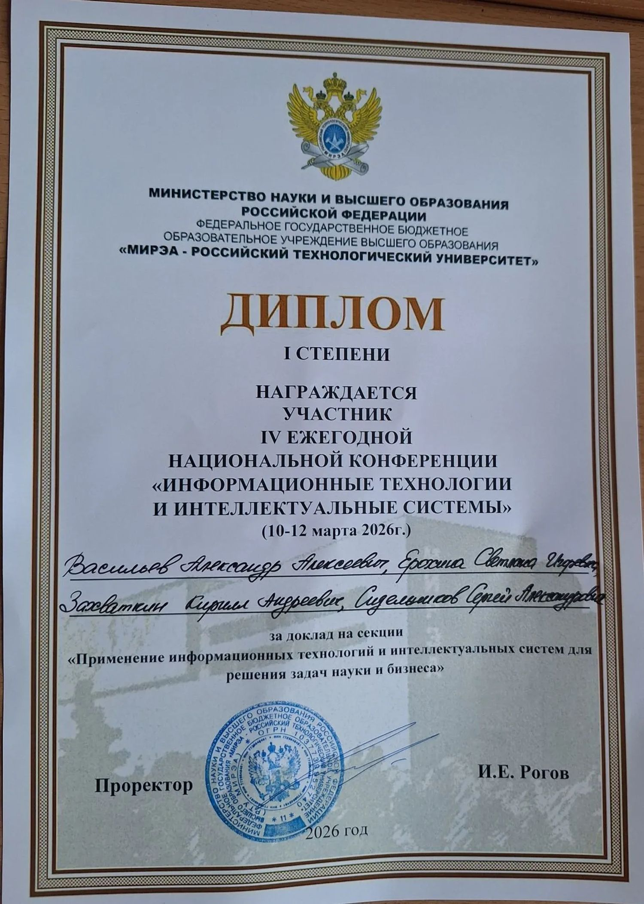

  <strong>Разработка ПО · Frontend · UI/UX · Бизнес-анализ · Системный анализ</strong>
   
  Software Development · Frontend & UI/UX · Business & Systems Analysis

 

### Обо мне

Привет! Я **Светлана Ерохина**, студентка **4-го курса РТУ МИРЭА** по направлению **«Информационные системы и технологии»**, профиль **«Разработка кроссплатформенных бизнес-приложений»**.

Исследую задачи, анализирую требования, продумываю архитектуру и логику систем, проектирую интерфейсы и работаю над программными решениями.
Здесь собраны мои разработки, аналитические исследования, дизайн-проекты и эксперименты с технологиями.

> **EN:** I'm an Information Systems and Technology student exploring software development, frontend, UI/UX design, business analysis and systems analysis.

---

### Направления

| 💻 Разработка ПО | 🎨 Frontend и UI/UX |
| :--- | :--- |
| Учебные приложения, работа с API, Python и Kotlin, поиск технических решений. | HTML, CSS, JavaScript, макеты и прототипирование интерфейсов в Figma. |
| 📊 **Бизнес-анализ** | 🧩 **Системный анализ** |
| Исследование задач и пользователей, анализ процессов, CJM, SWOT, Kano и ICE. | Требования к системам, UML/BPMN, проектирование данных, SQL и REST API. |

### Проекты

| Проект | Что внутри | Направления |
| :--- | :--- | :--- |
| **[TutorHammer](https://github.com/erokhha/TutorApplication)** | Учебный проект мобильного приложения для репетиторов: Kotlin, UI/UX, пользовательские сценарии, модели данных и аналитические материалы. | Mobile · UI/UX · Аналитика |
| **SkillUp** · аналитические материалы готовятся к публикации | Концепция образовательной платформы: бизнес-модель, CJM, SWOT, исследование функций, Kano, ICE и риски. | Бизнес-анализ · Product Research |
| **[CTF Calendar Bot](https://github.com/erokhha/ctf-calendar-bot)** | Учебный Telegram-бот для отслеживания CTF-соревнований и работы с внешними API. | Python · Telegram Bot · API |
| **[Water Segmentation](https://github.com/erokhha/water-segmentation-project)** | Учебно-исследовательский проект сегментации воды на изображениях. | Python · PyTorch · Computer Vision |
| **[ToDo API](https://github.com/erokhha/ToDo-API-BSBO)** | Учебный API для задач, реализованный в рамках дисциплины по интероперабельности. | Python · FastAPI · REST API |

Проекты находятся на разных стадиях: часть реализована в коде, часть представлена исследованиями, документацией или прототипами.

### Технологии и инструменты

**Разработка**

`Python` · `Kotlin` · `JavaScript` · `HTML` · `CSS` · `FastAPI` · `Git` · `GitHub` · `Docker`

**Данные и интеграции**

`SQL` · `PostgreSQL` · `SQLite` · `MongoDB` · `REST API` · `HTTP` · `JSON` · `Postman`

**Аналитика и проектирование**

`BPMN` · `UML` · `ER-диаграммы` · `AS IS / TO BE` · `User Stories` · `CJM` · `SWOT` · `Kano` · `ICE` · `Figma` · `Miro` · `Excel`

Перечислены инструменты, с которыми работала преимущественно в учебных проектах; список не подразумевает экспертного владения каждым из них.

### Аналитические кейсы и документация

- **TutorHammer:** анализ целевой аудитории и требований, пользовательские сценарии, проектирование приложения и базы данных.
- **SkillUp:** бизнес-модель, конкурентная среда, клиентский путь, риски и приоритизация функциональности.
- **Автоматизация работы клиники:** моделирование бизнес-процессов AS IS / TO BE и анализ информационных систем.
- **Примеры технических заданий:** роли пользователей, функциональные требования, структура данных и интеграции.

## Достижения и сертификаты

**Диплом I степени · РТУ МИРЭА, 2026**

IV ежегодная национальная конференция
«Информационные технологии и интеллектуальные системы».

Награда за коллективный доклад в секции
«Применение информационных технологий и интеллектуальных систем для решения задач науки и бизнеса».

### Дополнительное образование

**DataCamp · 2026**

- GitHub Foundations — [Посмотреть сертификат](assets/certificates/certificate.pdf)
- GitHub Copilot Fundamentals (GH-300) — [Посмотреть сертификат](assets/certificates/github-copilot.pdf)
- Artificial Intelligence (AI) Leadership — [Посмотреть сертификат](assets/certificates/ai-leadership.pdf)

### Цифровые бейджи Credly

- [Цифровой бейдж №1](https://www.credly.com/badges/5bfee22c-4104-4bb2-9e7e-fd010eca07e2/public_url)
- [Цифровой бейдж №2](https://www.credly.com/badges/11ed5295-0927-4699-ae20-9ce0a64520cb/public_url)

